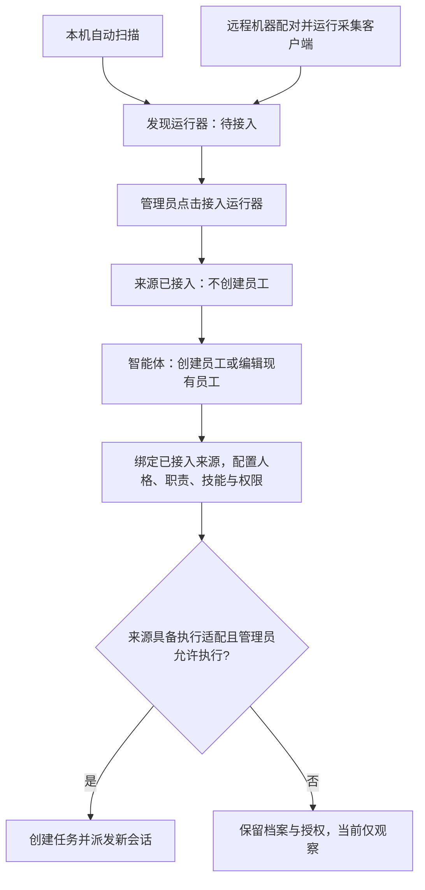

# 运行器接入与智能体绑定指南

本文对应“发现与接入”和“智能体”拆分后的流程。接入只登记可用运行器，不创建员工、不分配工位，也不设置人格或权限。

## 1. 三类对象与操作入口

| 对象 | 含义 | 管理入口 |
| --- | --- | --- |
| 采集机器 | 上报安装清单和进程信息的本机或远程电脑 | 发现与接入 → 采集机器 |
| 运行器来源 | 某台机器上的 Codex、Pi、WorkBuddy 等运行器，按机器与类型归并 | 发现与接入 → 发现的运行器 |
| 智能体员工 | 公司的岗位身份，拥有姓名、人格、职责、小队、Skills、权限和预算 | 智能体 → 创建 Agent / 编辑配置 / 权限设置 |

一个运行器来源可以绑定多个员工。例如，负责人、产品、研发、测试、运维可以共用本机 Codex，但每个人的档案、权限、工位和执行记录独立。平台派发任务时启动新会话，不接管扫描到的现有终端会话。PID 只用于诊断，不是员工身份。

展开运行实例后，优先显示采集到的窗口标题，其次显示进程名称，并保留 PID 和最近上报时间。一个进程可能有多个窗口，列表会展示其可读标题。标题来自操作系统窗口元数据，不能直接当作 Agent 内部会话名称；无窗口的 CLI 或标题读取不可用时显示“暂无可读窗口标题”。窗口本身提供的截断标题会原样展示。

当前源码与后台下载的采集脚本支持名称上报。macOS 在已有屏幕读取授权时查询匹配 PID 的窗口标题，不主动申请权限；Windows 尝试读取主窗口标题；其他系统提供进程名称。采集只上报可执行文件的名称，不上报完整路径、启动参数或会话正文。旧客户端仍可上报 PID，升级采集脚本后才会提供名称。参见 [Apple 窗口信息接口](https://developer.apple.com/documentation/coregraphics/cgwindowlistcopywindowinfo(_:_:))、[Windows 主窗口标题说明](https://learn.microsoft.com/en-us/dotnet/api/system.diagnostics.process.mainwindowtitle)。

## 2. 本机接入

1. 在运行工作台的系统账号下安装 Codex 或 Pi，并在该账号环境完成模型登录。平台“已接入执行”标签并不验证模型账号登录状态。
2. 打开 **发现与接入**，点击 **立即扫描本机**。默认也会在启动时扫描，之后按运行时设置的间隔扫描。
3. 核对来源为“本机”、发现状态和执行适配状态，点击 **接入运行器**。不需要填写员工姓名、人格或权限；重复接入不会重复创建资源。
4. 状态变为 **已接入** 后，进入 **智能体**，点击 **创建 Agent**，或编辑现有员工。
5. 在 **绑定运行器** 中选择已接入来源，填写姓名、岗位、人格、职责、小队、形象和 Skills，保存员工档案。
6. 在该员工的 **权限设置** 中确认平台执行授权、文件访问、公司工具和 MCP 服务授权。每位员工分别配置。
7. 在任务页创建任务并指定该员工，启动后检查执行过程、工具事件、结果和 Token 统计。首次验证宜使用范围明确的小任务。

扫描和执行共用 CLI 定位方式：显式 `OFFICE_CODEX_BIN` / `OFFICE_PI_BIN` 优先，其次 PATH、常用安装目录及 macOS ChatGPT / Codex 应用内置 CLI。显式配置错误时不会自动换用别的安装；调整服务环境后重启服务并重新扫描。

没有已接入来源时，新建员工选择器只提供演示运行器。演示用于验证页面和任务事件流，不调用真实模型，也不等于真实运行器已接入。

## 3. 远程机器接入

1. 新电脑安装 Node.js 22.13+，通过采集机器区域的 npm 命令安装客户端。工作台默认提供当前源码生成的匹配版本归档，无需等待公共 npm 发布。
2. 在「发现与接入 → 采集机器 → 接入新机器」填写机器名称、可达采集地址、终端类型和任务读取范围。
3. 点击「生成 login 命令」。窗口分别提供 npm 安装命令、一次性配对码、login 命令与后续 run 命令。先完成安装，再执行 login 并输入配对码。
4. 配对码 10 分钟有效、仅使用一次。生成的 login 命令带 `--run`，登录后持续采集。在机器表确认「在线」。
5. 接入需要使用的运行器，再到「智能体」创建或编辑员工并绑定。当前远程客户端支持采集和授权范围内的只读任务查询，尚不支持远程任务执行派发。
6. 不再使用的机器须先停止采集、改绑员工并等待离线，再点击「删除机器」。本机、有近期上报、仍有员工或活动任务使用的机器不能删除。

完整安装、地址选择、SSH 隧道、CLI 命令、配置、更新和排障步骤见 [远程机器接入与客户端使用指南](REMOTE_COLLECTOR_GUIDE.md)。相同说明可在页面的采集机器区域展开阅读。

## 4. 状态如何判断

| 维度 | 常见状态 | 判断依据 |
| --- | --- | --- |
| 发现状态 | 已安装、检测到运行器、未检测到安装、来源离线 | 扫描证据和机器心跳；不代表模型已登录 |
| 执行适配 | 已接入执行 | 当前支持本机 Codex / Pi 执行接口，并定位到对应 CLI |
| 执行适配 | 已适配，待定位 CLI | 平台支持该接口，但当前只有进程证据，未定位 CLI |
| 执行适配 | 未接入执行 | WorkBuddy、Antigravity 等来源目前只有发现与采集能力 |
| 执行适配 | 远程执行未接入 | 远程来源已被采集，但未实现远程任务执行 |
| 接入状态 | 待接入、已接入、已忽略 | 管理员是否将该运行器加入公司资源池 |
| 绑定员工 | 未绑定、N 位员工 | 当前使用该机器与运行器的员工数量，包含旧版默认使用本机 Codex / Pi 的员工；可展开名单并进入员工配置 |
| 员工执行授权 | 已允许执行、未允许执行、已授权待适配 | 每位员工的管理员授权与实际适配能力 |

“接入状态：已接入”和“执行适配：已接入执行”是不同维度。未适配来源也可登记接入并绑定观察型员工，但不能通过接入或勾选权限获得执行接口。员工保留观察绑定时显示“仅观察模式”。

绑定统计优先使用员工当前选择的运行器来源，其次兼容历史入职来源。没有来源 ID 的旧版 Codex / Pi 员工计入对应本机运行器，不计入远程同名运行器。切换来源后只计入新的来源，暂停或关闭执行授权不解除绑定。统计不会改写员工配置或自动接入运行器。

员工配置和权限设置中的文件授权均可修改、保存。选择 WorkBuddy、Antigravity、Pi 或受限岗位时不会重置已选授权，页面会说明当前是否生效。WorkBuddy、Antigravity 的“未接入执行”来自平台尚未实现其任务执行适配器，与是否安装、登录或接入资源池分别判断；预先授予写入权限不会使它们立即获得执行能力。

实际生效权限是执行适配、岗位上限和管理员授权的交集。Pi 当前关闭内置文件/终端工具；人事、财务的文件上限为只读。MCP 服务由自身控制外部访问权限。修改员工授权只影响新排队的任务，已有任务保留入队快照；要立即停止旧权限运行，先停止对应任务。

## 5. 兼容、约束与常见问题

- **旧“待建档”是什么意思？** 旧版将运行器发现和员工入职混在一起。新版不再提供该入口，待处理来源显示“待接入”，原草稿保留但不自动生成员工，也不再计入待入职审批。
- **现有员工会丢失吗？** 不会。显式绑定的旧来源保留连接关系；历史通用 Codex / Pi 员工仍可编辑原配置，不强制改绑。新员工或新绑定必须使用已接入来源。
- **能否绑定同一个 Codex 给五名员工？** 可以。它们共享运行器安装及其模型账号，但员工身份、授权、任务会话独立。并发仍受工作台运行时和预算限制。
- **为什么接入按钮报错？** 机器需在线且运行器当前可见；撤销的机器、离线来源和单个 PID 不能作为新的接入对象。
- **已忽略如何恢复？** 点击该来源的“重新接入”。后续扫描不会清空已有接入状态。
- **为什么绑定时被拒绝？** 来源未接入、被撤销、冒充不支持的执行方式，或切换来源时员工仍有排队/执行中的任务。先处理相应条件后重试。
- **能否从旧接口继续创建员工？** Web API 的旧 `review` / `approve` 入职入口返回 409，引导使用新流程。新接入接口为 `POST /api/candidates/:id/connect`，不接受员工档案；创建/编辑员工使用 `POST /api/agents` 并传 `runnerCandidateId`。这些写操作仅限管理员。
- **人事 Agent 如何建员工？** `office_candidates` 查询已接入来源；`office_hire` 绑定指定来源，或沿用人事当前已绑定的来源。旧建档工具不再提供，人事不能绕过管理员接入资源。

初始化研发小队前，也需先接入本机 Codex；脚本会为五名员工绑定该来源，已有同名员工不覆盖。参见 [研发小队说明](DEVELOPMENT_SQUAD.md)。

## 6. 验收清单

1. 扫描到新来源时显示“待接入”，新建员工下拉框中不可选。
2. 点击接入后显示“已接入”；员工数、工位数、执行数均不增加，重复点击不重复接入。
3. 智能体中可绑定该来源，创建两个员工后来源显示“2 位员工”，两者权限可分别修改。
4. 未适配或远程来源可以绑定观察型员工，但派发任务被拒绝。
5. 配对撤销后不再接受上报，也不能创建新的来源绑定。
6. 重新扫描、重启服务后接入与绑定关系仍存在，旧员工和未完成任务保留。
